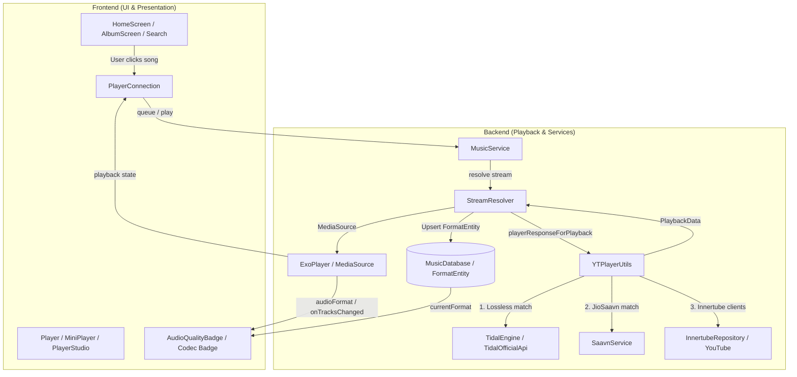

# Vox Architecture & Playback Pipeline (Frontend vs. Backend)

This document provides a clean structural map of Vox's frontend (Compose UI, player presentation) and backend (stream resolution, audio services, ExoPlayer media pipeline) for agents and developers.

---

## 1. High-Level Architecture Diagram



---

## 2. Directory & Component Mapping

### Backend: Stream Resolution & Core Services

| Module / File Path | Role | Key Functions / Responsibilities |
| :--- | :--- | :--- |
| [`app/src/main/kotlin/com/vox/music/playback/MusicService.kt`](file:///c:/Avoxapps/Convx-main/app/src/main/kotlin/com/vox/music/playback/MusicService.kt) | Core Android Service | Manages background ExoPlayer instance, playback lifecycle, DSP processors, and stream caching. |
| [`app/src/main/kotlin/com/vox/music/playback/MusicService.kt` (StreamResolver)](file:///c:/Avoxapps/Convx-main/app/src/main/kotlin/com/vox/music/playback/MusicService.kt#L3761) | Media Source Builder | Calls resolver, caches stream URLs, builds progressive / HLS / DASH ExoPlayer media sources, updates `FormatEntity`. |
| [`app/src/main/kotlin/com/vox/music/utils/YTPlayerUtils.kt`](file:///c:/Avoxapps/Convx-main/app/src/main/kotlin/com/vox/music/utils/YTPlayerUtils.kt) | Central Resolution Router | Orchestrates Spine, Tidal, JioSaavn, and YouTube Innertube client fallback chain. |
| [`app/src/main/kotlin/com/vox/music/utils/tidal/TidalEngine.kt`](file:///c:/Avoxapps/Convx-main/app/src/main/kotlin/com/vox/music/utils/tidal/TidalEngine.kt) | Tidal Resolver | Matches track metadata (title, artist, duration) and fetches official FLAC/DASH or proxy stream. |
| [`app/src/main/kotlin/com/vox/music/utils/tidal/TidalOfficialApi.kt`](file:///c:/Avoxapps/Convx-main/app/src/main/kotlin/com/vox/music/utils/tidal/TidalOfficialApi.kt) | Tidal API Client | Performs OAuth-authenticated queries to Tidal's playback endpoints. |
| [`core/innertube/src/commonMain/kotlin/com/music/innertube/YouTube.kt`](file:///c:/Avoxapps/Convx-main/core/innertube/src/commonMain/kotlin/com/music/innertube/YouTube.kt) | YouTube Client Library | Low-level HTTP requests to InnerTube endpoints. |
| [`core/innertube/src/commonMain/kotlin/com/music/innertube/models/YouTubeClient.kt`](file:///c:/Avoxapps/Convx-main/core/innertube/src/commonMain/kotlin/com/music/innertube/models/YouTubeClient.kt) | Client Definitions | Definitions and user-agents for `IOS`, `ANDROID_VR`, `WEB_REMIX`, `TVHTML5`, etc. |
| [`app/src/main/kotlin/com/vox/music/db/entities/FormatEntity.kt`](file:///c:/Avoxapps/Convx-main/app/src/main/kotlin/com/vox/music/db/entities/FormatEntity.kt) | Stored Stream Metadata | Database model holding codec, bitrate, sample rate, and loudness for the active song. |

---

### Bridge: Controller & State Synchronization

| File Path | Role | Key Functions / Responsibilities |
| :--- | :--- | :--- |
| [`app/src/main/kotlin/com/vox/music/playback/PlayerConnection.kt`](file:///c:/Avoxapps/Convx-main/app/src/main/kotlin/com/vox/music/playback/PlayerConnection.kt) | UI-to-Service Bridge | Exposes Kotlin Flows (`isPlaying`, `playbackState`, `currentFormat`, `queue`) to Jetpack Compose UI. |
| [`app/src/main/kotlin/com/vox/music/playback/DownloadUtil.kt`](file:///c:/Avoxapps/Convx-main/app/src/main/kotlin/com/vox/music/playback/DownloadUtil.kt) | Offline Downloader | Downloads audio tracks based on chosen quality (`MAX`, `HIGH`, etc.). |

---

### Frontend: Jetpack Compose UI & Presentation

| Module / File Path | Role | Key Functions / Responsibilities |
| :--- | :--- | :--- |
| [`app/src/main/kotlin/com/vox/music/ui/player/AudioQualityBadge.kt`](file:///c:/Avoxapps/Convx-main/app/src/main/kotlin/com/vox/music/ui/player/AudioQualityBadge.kt) | Codec & Bitrate Badge | Collects `currentFormat` and `rememberLiveAudioFormat(playerConnection)` to display `MAX`, `CD`, `Opus`, `AAC`, bit-depth, and sample rate. |
| [`app/src/main/kotlin/com/vox/music/ui/player/Player.kt`](file:///c:/Avoxapps/Convx-main/app/src/main/kotlin/com/vox/music/ui/player/Player.kt) | Main Now Playing Sheet | Full-screen expanded player, progress slider, controls, lyrics toggle. |
| [`app/src/main/kotlin/com/vox/music/ui/player/MiniPlayer.kt`](file:///c:/Avoxapps/Convx-main/app/src/main/kotlin/com/vox/music/ui/player/MiniPlayer.kt) | Persistent Mini Player | Bottom bar player with quick play/pause, gestures, and expandable sheet. |
| [`app/src/main/kotlin/com/vox/music/ui/screens/settings/TidalSettings.kt`](file:///c:/Avoxapps/Convx-main/app/src/main/kotlin/com/vox/music/ui/screens/settings/TidalSettings.kt) | Tidal Settings UI | Engine mode selector (Hybrid, Tidal Only, Innertube Only), Quality Cap, Login/Logout. |
| [`app/src/main/kotlin/com/vox/music/ui/screens/settings/PlayerSettings.kt`](file:///c:/Avoxapps/Convx-main/app/src/main/kotlin/com/vox/music/ui/screens/settings/PlayerSettings.kt) | Audio & Sound Settings | Audio quality options (`AUTO`, `MAX`, `HIGH`, `LOW`), normalization, skip silence. |

---

## 3. Why Songs Don't Play & Badges Don't Appear

1. **Resolution Failure in `YTPlayerUtils`**:
   - When a track is clicked, `MusicService.StreamResolver.fetchResolvedStream` asks `YTPlayerUtils.playerResponseForPlayback` for stream data.
   - If Tidal is enabled without credentials or misses match, it falls back to InnerTube.
   - `YTPlayerUtils.MAIN_CLIENT` is set to `ANDROID_VR_1_43_32`. YouTube has aggressively blocked `ANDROID_VR` without valid account tokens across many networks.
   - When all fallback clients fail, `YTPlayerUtils` throws `PlaybackException(ERROR_CODE_REMOTE_ERROR)` or `IOException`.
2. **Badge Disappearance**:
   - In [`AudioQualityBadge.kt`](file:///c:/Avoxapps/Convx-main/app/src/main/kotlin/com/vox/music/ui/player/AudioQualityBadge.kt#L70-L75):
     ```kotlin
     val quality = audioQualityLabel(mime, codecs, bitrate, sampleRate) ?: return
     ```
   - When the backend fails to resolve a stream or ExoPlayer never transitions to `STATE_READY`, both `playerConnection.currentFormat` and `player.audioFormat` are `null`. The badge component returns immediately (`?: return`), rendering nothing.
