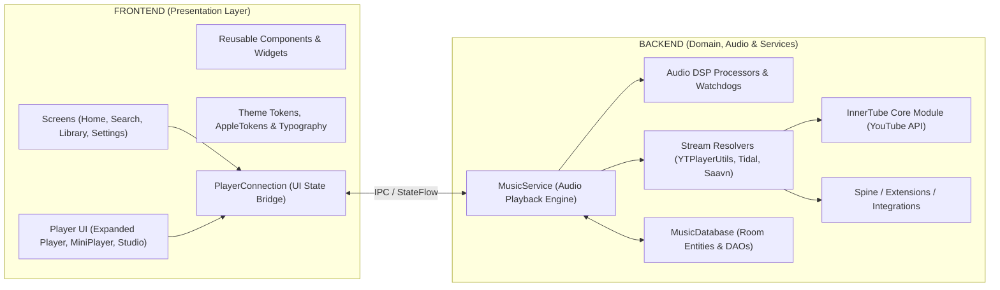

# Vox Full Project File Map (Backend vs Frontend)

This document provides a comprehensive, structured map of the entire codebase divided into **Backend (Engine, Storage, Audio, Network)** and **Frontend (UI, Screens, Components, Theme)**. Designed for easy navigation and understanding by AI agents and developers.

---

## 1. System Overview

---

## 2. Backend Modules & Files

### 2.1 Audio Playback Engine & Service
*Location: `app/src/main/kotlin/com/vox/music/playback/`*

| File | Purpose |
| :--- | :--- |
| [`MusicService.kt`](file:///c:/Avoxapps/Convx-main/app/src/main/kotlin/com/vox/music/playback/MusicService.kt) | Core Android Foreground Service running ExoPlayer, media notification, audio focus, sleep timer, and queue management. |
| [`MusicService.kt` (StreamResolver)](file:///c:/Avoxapps/Convx-main/app/src/main/kotlin/com/vox/music/playback/MusicService.kt#L3761) | Inner engine class that coordinates cache lookups, stream URL resolution, and builds progressive/HLS/DASH media sources. |
| [`DownloadUtil.kt`](file:///c:/Avoxapps/Convx-main/app/src/main/kotlin/com/vox/music/playback/DownloadUtil.kt) | Background audio download manager, caching tracks to local disk and managing upgrade/quality policies. |
| [`PlaybackErrorClassifier.kt`](file:///c:/Avoxapps/Convx-main/app/src/main/kotlin/com/vox/music/playback/PlaybackErrorClassifier.kt) | Classifies playback failures (network, codec, server, timeout) and directs recovery actions. |
| [`CrossfadeController.kt`](file:///c:/Avoxapps/Convx-main/app/src/main/kotlin/com/vox/music/playback/CrossfadeController.kt) | Handles gapless playback and crossfading between consecutive songs. |
| [`PlaybackSleepTimer.kt`](file:///c:/Avoxapps/Convx-main/app/src/main/kotlin/com/vox/music/playback/PlaybackSleepTimer.kt) | Sleep timer implementation for auto-stopping playback. |

### 2.2 DSP & Audio Processing Stage
*Location: `app/src/main/kotlin/com/vox/music/playback/audio/`*

| File | Purpose |
| :--- | :--- |
| [`AudiophileDspProcessor.kt`](file:///c:/Avoxapps/Convx-main/app/src/main/kotlin/com/vox/music/playback/audio/AudiophileDspProcessor.kt) | Audio tone stage: channel balance, crossfeed, pre-amp gain, 20Hz high-pass filter, mono summing, and midnight mode compression. |
| [`SpatialAudioProcessor.kt`](file:///c:/Avoxapps/Convx-main/app/src/main/kotlin/com/vox/music/playback/audio/SpatialAudioProcessor.kt) | Binaural virtualization and spatial audio processing. |
| [`VocalSuppressionAudioProcessor.kt`](file:///c:/Avoxapps/Convx-main/app/src/main/kotlin/com/vox/music/playback/audio/VocalSuppressionAudioProcessor.kt) | Center-channel audio cancellation for karaoke mode. |
| [`SilenceDetectorAudioProcessor.kt`](file:///c:/Avoxapps/Convx-main/app/src/main/kotlin/com/vox/music/playback/audio/SilenceDetectorAudioProcessor.kt) | Detects trailing or leading silence to skip empty audio sections. |
| [`LosslessStallWatchdogAudioProcessor.kt`](file:///c:/Avoxapps/Convx-main/app/src/main/kotlin/com/vox/music/playback/audio/LosslessStallWatchdogAudioProcessor.kt) | Monitors lossless decoders for stalls without crashes and forces auto-fallback to standard audio. |

### 2.3 Stream Resolvers & Providers
*Location: `app/src/main/kotlin/com/vox/music/utils/` and sub-packages*

| File | Purpose |
| :--- | :--- |
| [`YTPlayerUtils.kt`](file:///c:/Avoxapps/Convx-main/app/src/main/kotlin/com/vox/music/utils/YTPlayerUtils.kt) | Primary routing resolver: passes queries to Spine, Tidal, JioSaavn, and InnerTube client fallbacks. |
| [`tidal/TidalEngine.kt`](file:///c:/Avoxapps/Convx-main/app/src/main/kotlin/com/vox/music/utils/tidal/TidalEngine.kt) | Tidal Max resolver: matches title/artist/duration to official Tidal catalog and public proxy. |
| [`tidal/TidalOfficialApi.kt`](file:///c:/Avoxapps/Convx-main/app/src/main/kotlin/com/vox/music/utils/tidal/TidalOfficialApi.kt) | Direct authenticated Tidal API client (PKCE OAuth). |
| [`tidal/TidalAuth.kt`](file:///c:/Avoxapps/Convx-main/app/src/main/kotlin/com/vox/music/utils/tidal/TidalAuth.kt) | Tidal PKCE authentication, token sealing with Android Keystore. |
| [`saavn/SaavnService.kt`](file:///c:/Avoxapps/Convx-main/app/src/main/kotlin/com/vox/music/utils/saavn/SaavnService.kt) | JioSaavn API provider for lossless/high-bitrate Bollywood and international content. |
| [`bot/BotDetectionMitigator.kt`](file:///c:/Avoxapps/Convx-main/app/src/main/kotlin/com/vox/music/utils/bot/BotDetectionMitigator.kt) | Guest session rotation and anti-bot mitigation handler. |
| [`potoken/PoTokenGenerator.kt`](file:///c:/Avoxapps/Convx-main/app/src/main/kotlin/com/vox/music/utils/potoken/PoTokenGenerator.kt) | Generates web client proof-of-origin tokens (PoToken) for InnerTube requests. |

### 2.4 Core InnerTube Library Module
*Location: `core/innertube/`*

| File / Package | Purpose |
| :--- | :--- |
| [`InnerTube.kt`](file:///c:/Avoxapps/Convx-main/core/innertube/src/commonMain/kotlin/com/music/innertube/InnerTube.kt) | Ktor HTTP client configured for YouTube Music API endpoints. |
| [`YouTube.kt`](file:///c:/Avoxapps/Convx-main/core/innertube/src/commonMain/kotlin/com/music/innertube/YouTube.kt) | Kotlin Multiplatform InnerTube repository (search, playlists, albums, next, player). |
| [`models/YouTubeClient.kt`](file:///c:/Avoxapps/Convx-main/core/innertube/src/commonMain/kotlin/com/music/innertube/models/YouTubeClient.kt) | Client configurations (`IOS`, `ANDROID_VR`, `WEB_REMIX`, `TVHTML5`). |
| [`pages/`](file:///c:/Avoxapps/Convx-main/core/innertube/src/commonMain/kotlin/com/music/innertube/pages/) | Parsers for Home, Explore, Artist, Album, and Search responses. |

### 2.5 Database & Persistence
*Location: `app/src/main/kotlin/com/vox/music/db/`*

| File / Package | Purpose |
| :--- | :--- |
| [`MusicDatabase.kt`](file:///c:/Avoxapps/Convx-main/app/src/main/kotlin/com/vox/music/db/MusicDatabase.kt) | Room database instance with automated schema migrations. |
| [`entities/SongEntity.kt`](file:///c:/Avoxapps/Convx-main/app/src/main/kotlin/com/vox/music/db/entities/SongEntity.kt) | Cached track metadata (id, title, artists, duration, thumbnail). |
| [`entities/FormatEntity.kt`](file:///c:/Avoxapps/Convx-main/app/src/main/kotlin/com/vox/music/db/entities/FormatEntity.kt) | Stream audio facts (bitrate, sample rate, codec, loudness). |
| [`entities/PlaylistEntity.kt`](file:///c:/Avoxapps/Convx-main/app/src/main/kotlin/com/vox/music/db/entities/PlaylistEntity.kt) | User playlists and local favorites. |
| [`dao/`](file:///c:/Avoxapps/Convx-main/app/src/main/kotlin/com/vox/music/db/dao/) | Data Access Objects (`SongDao`, `ArtistDao`, `PlaylistDao`, `FormatDao`). |

---

## 3. Bridge Layer (State & Controllers)

*Location: `app/src/main/kotlin/com/vox/music/playback/` and `viewmodels/`*

| File | Purpose |
| :--- | :--- |
| [`PlayerConnection.kt`](file:///c:/Avoxapps/Convx-main/app/src/main/kotlin/com/vox/music/playback/PlayerConnection.kt) | Primary bridge connecting `MusicService` to Compose UI. Holds `StateFlow`s for `playbackState`, `isPlaying`, `currentFormat`, `queue`, and playback commands. |
| [`AudioDeviceBottomSheet.kt`](file:///c:/Avoxapps/Convx-main/app/src/main/kotlin/com/vox/music/core/AudioDeviceBottomSheet.kt) | Handles audio output routing (Bluetooth, wired, phone speaker) and quality selector bridge. |
| [`viewmodels/`](file:///c:/Avoxapps/Convx-main/app/src/main/kotlin/com/vox/music/viewmodels/) | ViewModels managing state for Home, Explore, Library, Search, and Album screens. |

---

## 4. Frontend Modules & Files (Compose UI)

### 4.1 Player & Presentation
*Location: `app/src/main/kotlin/com/vox/music/ui/player/`*

| File | Purpose |
| :--- | :--- |
| [`Player.kt`](file:///c:/Avoxapps/Convx-main/app/src/main/kotlin/com/vox/music/ui/player/Player.kt) | Full-screen expanded Now Playing sheet (cover art, controls, scrubber, lyrics sheet). |
| [`MiniPlayer.kt`](file:///c:/Avoxapps/Convx-main/app/src/main/kotlin/com/vox/music/ui/player/MiniPlayer.kt) | Persistent floating bottom bar mini-player with swipe-to-skip and expand transitions. |
| [`AudioQualityBadge.kt`](file:///c:/Avoxapps/Convx-main/app/src/main/kotlin/com/vox/music/ui/player/AudioQualityBadge.kt) | Live audio quality & codec badge (`MAX · 24/96`, `CD · 16/44.1`, `Opus`, `AAC`, etc.). |
| [`Queue.kt`](file:///c:/Avoxapps/Convx-main/app/src/main/kotlin/com/vox/music/ui/player/Queue.kt) | Active playback queue sheet, reorderable track list. |
| [`PlayerStudio.kt`](file:///c:/Avoxapps/Convx-main/app/src/main/kotlin/com/vox/music/ui/player/PlayerStudio.kt) | Alternate player skins: Vinyl turntable, Cassette deck, Typography, and Parallax art. |
| [`Lyrics.kt`](file:///c:/Avoxapps/Convx-main/app/src/main/kotlin/com/vox/music/ui/component/Lyrics.kt) | Synchronized word-by-word and line-by-line animated lyrics renderer. |

### 4.2 Screens
*Location: `app/src/main/kotlin/com/vox/music/ui/screens/`*

| File / Folder | Purpose |
| :--- | :--- |
| [`HomeScreen.kt`](file:///c:/Avoxapps/Convx-main/app/src/main/kotlin/com/vox/music/ui/screens/HomeScreen.kt) | Application landing screen: Quick picks, forgotten favorites, albums, and recent tracks. |
| [`ExploreScreen.kt`](file:///c:/Avoxapps/Convx-main/app/src/main/kotlin/com/vox/music/ui/screens/ExploreScreen.kt) | Charts, new releases, moods and genres feed. |
| [`search/SearchScreen.kt`](file:///c:/Avoxapps/Convx-main/app/src/main/kotlin/com/vox/music/ui/screens/search/SearchScreen.kt) | Online and offline search with real-time suggestions. |
| [`artist/ArtistScreen.kt`](file:///c:/Avoxapps/Convx-main/app/src/main/kotlin/com/vox/music/ui/screens/artist/ArtistScreen.kt) | Artist details, top songs, discography, and related artists. |
| [`AlbumScreen.kt`](file:///c:/Avoxapps/Convx-main/app/src/main/kotlin/com/vox/music/ui/screens/AlbumScreen.kt) | Full album details with drifting Ken Burns header art. |
| [`library/`](file:///c:/Avoxapps/Convx-main/app/src/main/kotlin/com/vox/music/ui/screens/library/) | User library: downloaded tracks, playlists, artists, albums, and history. |
| [`settings/`](file:///c:/Avoxapps/Convx-main/app/src/main/kotlin/com/vox/music/ui/screens/settings/) | Settings screens: |
| ↳ [`PlayerSettings.kt`](file:///c:/Avoxapps/Convx-main/app/src/main/kotlin/com/vox/music/ui/screens/settings/PlayerSettings.kt) | Audio quality selector, volume normalization, skip silence. |
| ↳ [`TidalSettings.kt`](file:///c:/Avoxapps/Convx-main/app/src/main/kotlin/com/vox/music/ui/screens/settings/TidalSettings.kt) | Tidal engine modes (`HYBRID`, `TIDAL_ONLY`, `INNERTUBE_ONLY`), quality caps, login. |
| ↳ [`AppearanceSettings.kt`](file:///c:/Avoxapps/Convx-main/app/src/main/kotlin/com/vox/music/ui/screens/settings/AppearanceSettings.kt) | Themes, accent color, corner radius, glass effects. |
| ↳ [`LiveIslandSettings.kt`](file:///c:/Avoxapps/Convx-main/app/src/main/kotlin/com/vox/music/ui/screens/settings/LiveIslandSettings.kt) | Camera cut-out pill and notification lyric settings. |

### 4.3 UI System & Design Tokens
*Location: `app/src/main/kotlin/com/vox/music/ui/theme/` and `core/design-system/`*

| File | Purpose |
| :--- | :--- |
| [`Theme.kt`](file:///c:/Avoxapps/Convx-main/app/src/main/kotlin/com/vox/music/ui/theme/Theme.kt) | Top-level AppTheme, dark/light paper palettes, dynamic color generation. |
| [`AppleTokens.kt`](file:///c:/Avoxapps/Convx-main/app/src/main/kotlin/com/vox/music/ui/theme/AppleTokens.kt) | Apple / iOS design token bridges (surfaces, hair-lines, typography). |
| [`Type.kt`](file:///c:/Avoxapps/Convx-main/app/src/main/kotlin/com/vox/music/ui/theme/Type.kt) | Typography scales (Chillax display fonts, body typography). |
| [`MotionTokens.kt`](file:///c:/Avoxapps/Convx-main/core/design-system/src/commonMain/kotlin/com/vox/music/designsystem/MotionTokens.kt) | Physics-based spring animations for sheet expansions and tab transitions. |

### 4.4 Live Island & Widgets
*Location: `app/src/main/kotlin/com/vox/music/island/` and `widget/`*

| File | Purpose |
| :--- | :--- |
| [`IslandOverlayController.kt`](file:///c:/Avoxapps/Convx-main/app/src/main/kotlin/com/vox/music/island/IslandOverlayController.kt) | WindowManager overlay displaying the cut-out capsule on top of other apps. |
| [`LiveIslandPill.kt`](file:///c:/Avoxapps/Convx-main/app/src/main/kotlin/com/vox/music/ui/component/LiveIslandPill.kt) | In-app cut-out lyric pill animation. |
| [`VoxWidgetManager.kt`](file:///c:/Avoxapps/Convx-main/app/src/main/kotlin/com/vox/music/widget/VoxWidgetManager.kt) | Homescreen widgets for playback controls and artwork. |

---

## 5. Quick Reference for Maintenance & Bug Fixing

| When working on... | Inspect Backend Files First | Inspect Frontend Files First |
| :--- | :--- | :--- |
| **Audio doesn't play / stream dead** | `YTPlayerUtils.kt`, `InnerTube.kt`, `YouTubeClient.kt` | `PlayerConnection.kt` |
| **Codec / Bitrate badge missing** | `YTPlayerUtils.kt`, `FormatEntity.kt` | `AudioQualityBadge.kt` |
| **Tidal login / stream failure** | `TidalEngine.kt`, `TidalOfficialApi.kt`, `TidalAuth.kt` | `TidalSettings.kt` |
| **Audio sound / EQ / DSP distortions** | `AudiophileDspProcessor.kt`, `MusicService.kt` | `PlayerSettings.kt` |
| **Lyrics sync / display issues** | `LyricsUtils.kt`, `IslandNotificationLyrics.kt` | `Lyrics.kt`, `LiveIslandPill.kt` |
